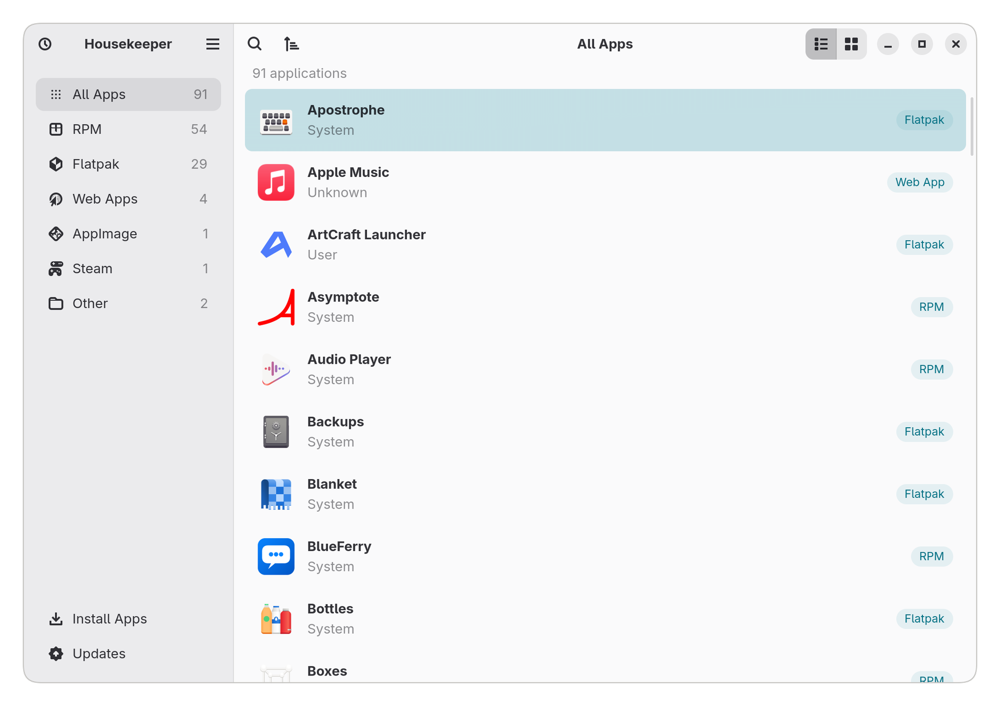
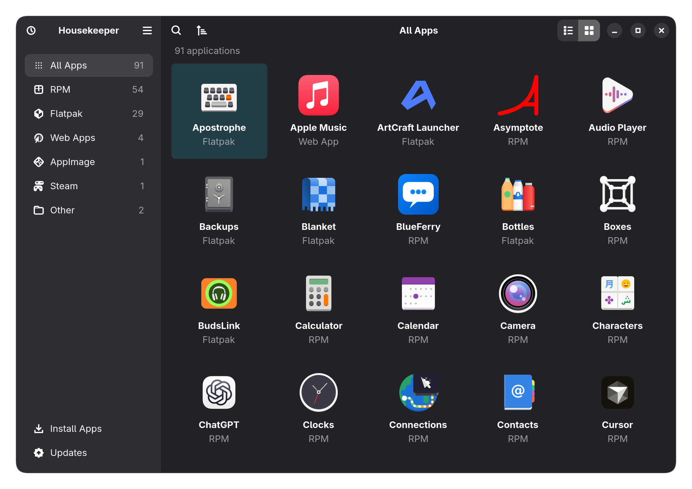

#  Housekeeper

[](https://github.com/yuelinxin/housekeeper/releases/latest)
[](https://copr.fedorainfracloud.org/coprs/yuelinxin/housekeeper/)
[](LICENSE)

A simple, unified app manager for Linux desktops. Discover, install, and manage
applications from different sources in one clean interface.

Install native packages and Flatpak apps, add website launchers, import AppImages,
and manage software sources. Browse everything in a searchable inventory, with
update and removal actions where supported. Housekeeper recognizes RPM, DEB,
Pacman and APK packages, Flatpak and Snap applications,
independent AppImages, Chrome and Chromium web apps, PWAsForFirefox, and Steam game shortcuts.

<p align="center">
  
  
</p>

## Features

- Browse a searchable list or grid, filter by source, and sort by name, size, or Last Updated.
- Open search with Ctrl+F and Preferences with Ctrl+comma; choose automatic or manual list refresh.
- Keep browsing, launching, and managing apps while the inventory refreshes in the background.
- Keep working while apps install, update or uninstall: progress shows on the page you started from and in the Activity button, which also lists this session's recent results.
- See which search results are already installed, and open their details from the install page.
- Install apps from the sidebar's Install Apps page: one search covers Flatpak, native packages and Snap, picking a source when several offer an app; enter a website to add a web app, or open a downloaded AppImage, RPM/DEB, `.flatpakref` or `.flatpak` file. Refresh the app list from the sidebar menu.
- Search native and Flatpak apps by name or keyword, review their source and scope, and install the selected app with its dependencies.
- Add Chrome or Chromium website launchers and import AppImages, with automatic or custom desktop icons.
- Manage system and Flatpak software sources in Preferences; enable or disable sources and import Flatpak repository files or HTTPS links.
- Inspect versions, file locations, installation scope, and hidden entries.
- Open apps from their details page and see available updates beside their names.
- Customize desktop launcher icons and restore the originals; GNOME also supports matching icons in docks and task panels.
- Preview RPM and Flatpak updates and removal where supported, preserving personal data by default.
- Choose whether to keep or delete user data when uninstalling a Flatpak app.
- Choose manual or on-entry update checks, daily or weekly, for RPM and Flatpak.
- Update supported RPM installations of Housekeeper from the sidebar; it restarts into the new version. Other installations show update instructions.
- Move eligible AppImages and verified Housekeeper website launchers to Trash; use external managers for other web apps and Steam games.

## Current support

Housekeeper can install native packages through PackageKit and apps from configured
Flatpak sources. AppStream catalogues provide app names, descriptions and icons;
search falls back to package names or Flatpak IDs when catalogue matches are unavailable.
Native installation requires a working PackageKit backend for the host distribution.
Pacman installations remain external: ALPM installation can also upgrade unrelated
system packages, which Housekeeper's single-app confirmation does not cover;
immutable systems retain external package management. Housekeeper does not perform
system upgrades. Flatpak removal can delete the current user's app data and permissions
when explicitly selected. Software sizes exclude shared runtimes and dependencies;
unavailable sizes and update dates stay unknown.

Website launchers need only a URL and default to Chrome, with Chromium as an option.
They open in their own browser window and use the website's icon when available.
They do not register a browser-installed PWA. Verified launchers created by Housekeeper
can be uninstalled while keeping browser data and icons. AppImages use the standard
executable icon; both allow a custom icon. AppImage imports copy the selected file
to `~/AppImages`, make it executable, and create a
desktop launcher without running the file. Steam opens its library; Snap search
opens the selected app in the Snap Store to finish installation.

Update and removal support varies by source. DEB, Pacman, APK, and Snap provide
external update/removal instructions. Direct RPM removal is unavailable on the tested
Fedora backends; Housekeeper provides guidance instead. See
[compatibility](docs/compatibility.md) for supported environments and limitations.

## Requirements

- Python 3.10+ with PyGObject, GTK 4.12+, and libadwaita 1.4+
- A graphical desktop session; GNOME Shell itself is not required
- A running Polkit authentication agent for system package and Flatpak operations.
  GNOME and KDE Plasma start one; on Hyprland or Sway, start one such as
  `hyprpolkitagent` or `polkit-gnome`

GNOME and KDE Plasma are the main desktop targets. Hyprland, Sway and other Wayland
compositors run the same GTK interface with its own bundled icons, but have not had
desktop acceptance testing. Outside GNOME, custom app icons change desktop launchers
only; docks and panels may keep their own icons.
- Optional RPM, PackageKit, and Flatpak integrations for their respective sources
- Optional AppStream bindings and distribution catalogues for application search metadata
- Optional `squashfs-tools` for reading AppImage desktop identities without executing them

## Install on Fedora

On Fedora 43, 44 or 45, enable the [COPR repository](https://copr.fedorainfracloud.org/coprs/yuelinxin/housekeeper/)
and install Housekeeper:

```sh
sudo dnf copr enable yuelinxin/housekeeper
sudo dnf install housekeeper
```

New releases are available through normal system updates. Update checks on the
Updates page also look for a new Housekeeper package, which the sidebar then offers
to install and restart into, or run `sudo dnf upgrade housekeeper`.
To uninstall Housekeeper, run `sudo dnf remove housekeeper`.

## Install on Ubuntu or Debian

Native DEB packages are built for Ubuntu 24.04 and Debian 13. Download the one for
your distribution from the [latest release](https://github.com/yuelinxin/housekeeper/releases/latest),
for example `housekeeper_VERSION-1+ubuntu24.04_all.deb` or
`housekeeper_VERSION-1+debian13_all.deb`, and install it with APT so its dependencies
are installed too:

```sh
sudo apt install ./housekeeper_*+ubuntu24.04_all.deb
```

Use `debian13` instead of `ubuntu24.04` on Debian. To update, install a newer DEB the same way. These standalone packages do not add
an APT repository or provide automatic Housekeeper updates. Remove Housekeeper
with `sudo apt remove housekeeper`.

The recommended dependencies enable PackageKit, Flatpak and AppStream integration.
DEB apps have ownership, version and size information; native updates and removal
remain in the system package manager. GTK checks cover GNOME and KDE session
identities; actual Plasma panels and graphical authorization still require the
[desktop acceptance checks](docs/desktop-acceptance.md).

Ubuntu 22.04 and Debian 12's default libraries are below the supported runtime
floor. See [compatibility](docs/compatibility.md) for operation-specific support.

## Install on Arch Linux

Each [release](https://github.com/yuelinxin/housekeeper/releases/latest) includes
`housekeeper-VERSION-1-any.pkg.tar.zst` for current Arch Linux, with the `PKGBUILD`
and `housekeeper-VERSION-arch.tar.gz` it was built from. Bring the system up to date,
then install the package:

```sh
sudo pacman -Syu
sudo pacman -U ./housekeeper-*-1-any.pkg.tar.zst
```

To rebuild it instead, put the `PKGBUILD` and `-arch.tar.gz` in one directory and run
`makepkg -si`. To build from this checkout, install the build tools and let `makepkg` resolve
the remaining dependencies:

```sh
sudo pacman -Syu --needed base-devel git python
python3 build-aux/source_archive.py
python3 build-aux/arch_package.py
cd dist/arch
makepkg -si
```

The generated PKGBUILD includes the exact source archive checksum. These standalone
packages do not register a repository: install a newer package the same way to
update Housekeeper, and use `sudo pacman -R housekeeper` to remove it. There is no
AUR package yet.

Pacman inventory includes package ownership, version, installed size and installation
date, including AUR-built packages already installed with pacman. Optional `flatpak`
enables Flatpak management; `packagekit`, `appstream` and `archlinux-appstream-data`
enable native app search. Native installation, updates and removal use the external
system package manager. Arch requires full system upgrades; do not use `pacman -Sy`
alone before installing packages. See [Arch's maintenance guidance](https://wiki.archlinux.org/title/System_maintenance#Partial_upgrades_are_unsupported).

Tests cover current Arch x86_64 containers and GTK with GNOME/KDE session identities.
A real Arch Plasma/GNOME session, Arch Linux ARM and derivatives such as Manjaro
remain separate acceptance targets.

## Build and run

On Fedora:

```sh
sudo dnf install python3-gobject gtk4 libadwaita meson ninja-build glib2-devel gettext
sudo dnf install python3-rpm PackageKit PackageKit-glib flatpak-libs appstream appstream-data
meson setup build --prefix=/usr
meson compile -C build
./build/housekeeper-dev
```

The second command enables optional integrations. On Ubuntu 24.04 or Debian 13,
the equivalent dependencies are:

```sh
sudo apt install python3-gi gir1.2-gtk-4.0 gir1.2-adw-1 librsvg2-common adwaita-icon-theme meson ninja-build libglib2.0-dev gettext
sudo apt install packagekit gir1.2-packagekitglib-1.0 flatpak gir1.2-flatpak-1.0 appstream gir1.2-appstream-1.0 squashfs-tools
```

Then use the same Meson commands above. Distribution packages pass
`-Dpackage_format=rpm`, `deb` or `none` so the desktop entry only offers to open
package files of the host's own family; the default `all` keeps both. The development launcher rebuilds
changed resources before starting. Use `GSETTINGS_BACKEND=memory` to try it without
saving preferences.

## Development

See [testing and releases](docs/testing.md) for test commands, disposable integration
environments, and packaging. [Architecture](docs/architecture.md) describes the
implementation; [validation](docs/validation.md) records completed checks and known gaps.
Run package-manager integration tests only in their disposable containers.

## Privacy and diagnostics

Housekeeper has no telemetry, account, or background update service. Preferences
and update results are stored locally. Package searches, installations, and update
checks may contact configured repositories; Snap searches contact the Snap Store through snapd.
Adding a website launcher may fetch its page and icon directly, without browser cookies
or a third-party icon service.
System operations use the desktop's Polkit authentication dialog when required;
Housekeeper never collects passwords.

Update errors are logged in `~/.local/state/housekeeper/housekeeper.log`
(or under `$XDG_STATE_HOME`). Set `HOUSEKEEPER_DEBUG=1` for additional diagnostics.
Review logs before sharing: they can include application names and file paths.

The interface is currently English-only, with gettext support for future translations.

## License

Code is [MIT](LICENSE). AppStream metadata and the bundled Flatpak symbol are
CC0-1.0; bundled Adwaita UI icons are LGPL-3.0-only. See
[icon attribution and licenses](data/icons/README.md). Application artwork keeps
its original license.
